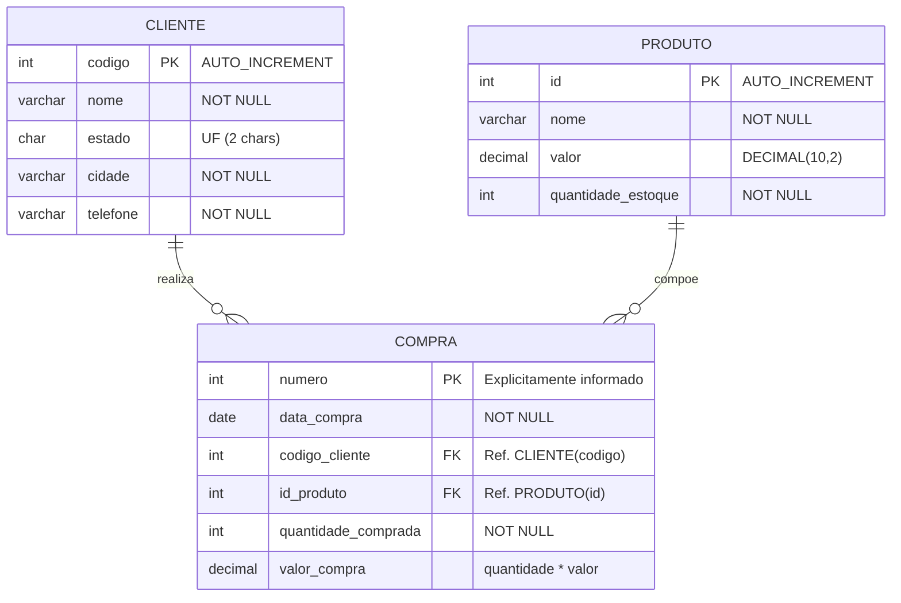

# Loja Virtual (`LOJABD`) — Modelagem e Consultas SQL (MySQL 5.6 / SQL Fiddle)


Projeto prático da disciplina **Gerenciamento e Desenvolvimento em Banco de Dados**, focado na criação do banco de dados relacional **`LOJABD`** para uma loja virtual — contemplando definição de esquema (**DDL**), carga de registros (**DML**) e consultas analíticas com junções (**DQL / `JOIN`**) no **MySQL 5.6** via **SQL Fiddle**, além de scripts em Python para validação automatizada da lógica SQL e geração do relatório acadêmico conforme as normas **ABNT**.

---

## Modelo Entidade-Relacionamento (`LOJABD`)



---

## Etapas da Atividade e Resultados Esperados

### Etapa 1 — DDL (`CREATE TABLE` com `InnoDB`)
- Criação das tabelas `CLIENTE` (`7` registros), `PRODUTO` (`4` registros) e `COMPRA` (`10` registros), utilizando `ENGINE=InnoDB` para garantir a validação estrita das chaves estrangeiras `fk_compra_cliente` e `fk_compra_produto`.
- **Nota sobre o SQL Fiddle:** como o ambiente online provisiona automaticamente um esquema temporário isolado e restringe `CREATE DATABASE`/`USE`, essas instruções ficam comentadas em `sql/sqlfiddle_01_schema_ddl_dml.sql` e ativas em `sql/01_schema_local_mysql56.sql` para uso em servidor MySQL local.

### Etapa 2 — DML (`INSERT INTO` e datas relativas)
- Inserção dos clientes, produtos e compras com datas relativas calculadas de forma segura em MySQL 5.6 via `DATE_ADD(CURRENT_DATE, INTERVAL n DAY)` e `DATE_SUB(CURRENT_DATE, INTERVAL n DAY)` (evitando erros de conversão numérica `YYYYMMDD` em `CURRENT_DATE + n`).
- Valor total de cada venda (`valor_compra`) calculado exatamente como `quantidade_comprada * produto.valor`.

### Etapa 3 — DQL (3 Consultas com `JOIN`)

| Consulta | Objetivo | Tipo de Junção | Resultado Esperado |
|---|---|---|---|
| **Consulta 1** | Retornar `numero_venda`, `nome_cliente`, `nome_produto` e `valor_compra`, ordenando por `numero` | `INNER JOIN` (3 tabelas) | `10` vendas ordenadas de `1` a `10` (de `150.00` a `3500.00`) |
| **Consulta 2** | Listar nome de todos os clientes e código da compra (`NULL` para quem não comprou) | `LEFT JOIN` (`CLIENTE` -> `COMPRA`) | `11` linhas, exibindo `Rian` com `codigo_compra = NULL` |
| **Consulta 3** | Listar nome único (`DISTINCT`) e telefone de clientes que compraram antes da data atual | `INNER JOIN` + `DISTINCT` + `WHERE data_compra < CURRENT_DATE` | `3` clientes únicos ordenados: `Caio`, `Marcos` (2 compras passadas deduplicadas) e `Penelope` |

---

## Como Executar

### 1. No SQL Fiddle (MySQL 5.6)
1. Acesse [http://sqlfiddle.com/](http://sqlfiddle.com/) e selecione **MySQL 5.6** na barra superior.
2. Copie o conteúdo de [`sql/sqlfiddle_01_schema_ddl_dml.sql`](sql/sqlfiddle_01_schema_ddl_dml.sql), cole no painel esquerdo (**Schema**) e clique em **Build Schema**.
3. Copie um bloco por vez de [`sql/sqlfiddle_02_consultas_join.sql`](sql/sqlfiddle_02_consultas_join.sql), cole no painel direito (**Run SQL**) e clique em **Run SQL**.

### 2. Em Servidor MySQL 5.6 Local
```bash
mysql -u root -p < sql/01_schema_local_mysql56.sql
mysql -u root -p LOJABD < sql/sqlfiddle_02_consultas_join.sql
```

### 3. Validação Automatizada em Python (SQLite Mirror)
Verifica regras sintáticas do SQL Fiddle, integridade referencial, cálculos de `valor_compra` e resultados exatos das 3 consultas:
```bash
python scripts/verificar_sql.py
```

---

## Evidências de Execução

As capturas de tela em tela inteira obtidas diretamente do SQL Fiddle (MySQL 5.6) estão armazenadas em [`evidencias/`](evidencias/README.md):

- `evidencias/01_ddl_dml_schema.png` — Compilação DDL/DML (`Build Schema`) e conferência das contagens das 3 tabelas
- `evidencias/02_consulta1_join_vendas.png` — Consulta 1 (`INNER JOIN` vendas/clientes/produtos)
- `evidencias/03_consulta2_left_join_clientes.png` — Consulta 2 (`LEFT JOIN` destacando `Rian -> NULL`)
- `evidencias/04_consulta3_join_antes_data_atual.png` — Consulta 3 (`INNER JOIN` + `DISTINCT` para compras anteriores à data atual)

---

## Estrutura do Repositório

```text
.
├── sql/
│   ├── 01_schema_local_mysql56.sql      # Script completo (CREATE DATABASE + DDL + DML)
│   ├── sqlfiddle_01_schema_ddl_dml.sql  # Script DDL + DML adaptado ao sandbox do SQL Fiddle
│   └── sqlfiddle_02_consultas_join.sql  # Verificação de carga + 3 consultas com JOIN
├── scripts/
│   ├── verificar_sql.py                 # Validação automatizada dos scripts e resultados SQL
│   ├── gerar_relatorio.py               # Gerador do relatório DOCX conforme modelo ABNT
│   └── atualizar_word_pdf.ps1           # Atualização de Sumário automático e exportação PDF via Word COM
├── evidencias/
│   └── README.md                        # Guia dos prints em tela inteira do SQL Fiddle
├── dados_relatorio.json                 # Metadados institucionais de capa, folha de rosto e referências
├── LICENSE                              # Licença MIT
└── README.md
```

---

## Autor

**Bruno Souza** — Disciplina de *Gerenciamento e Desenvolvimento em Banco de Dados* (2026).  
Distribuído sob a licença [MIT](LICENSE).
