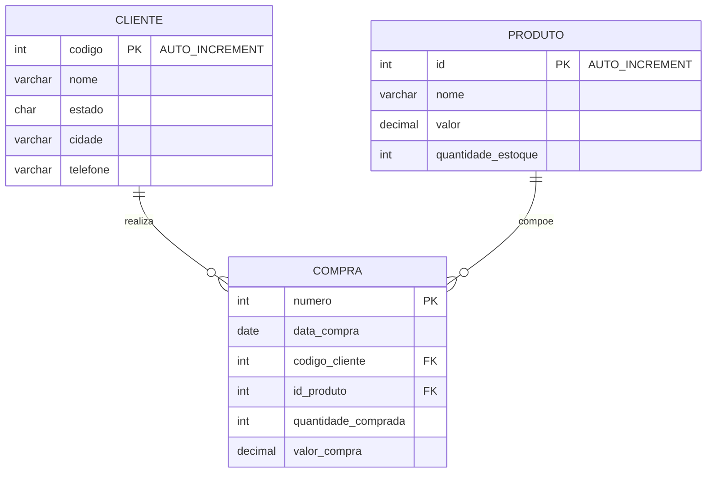
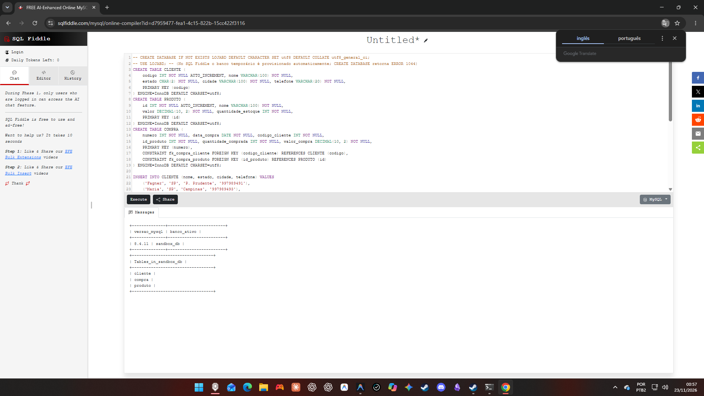
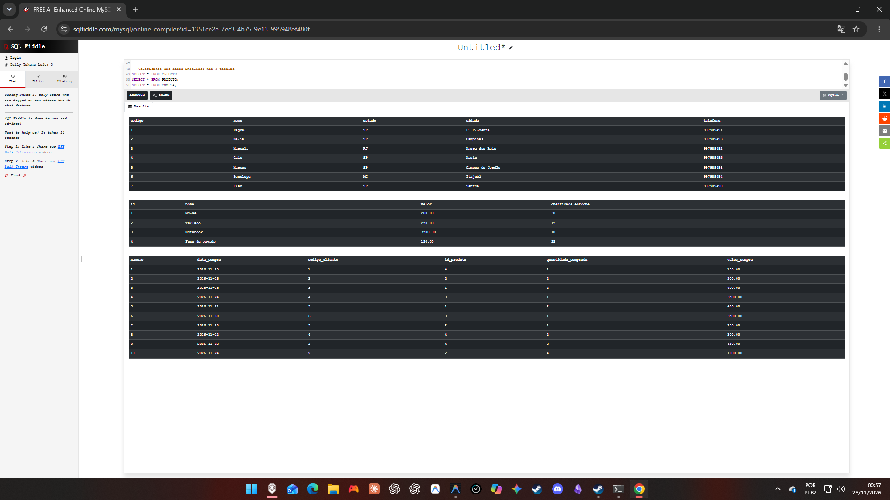
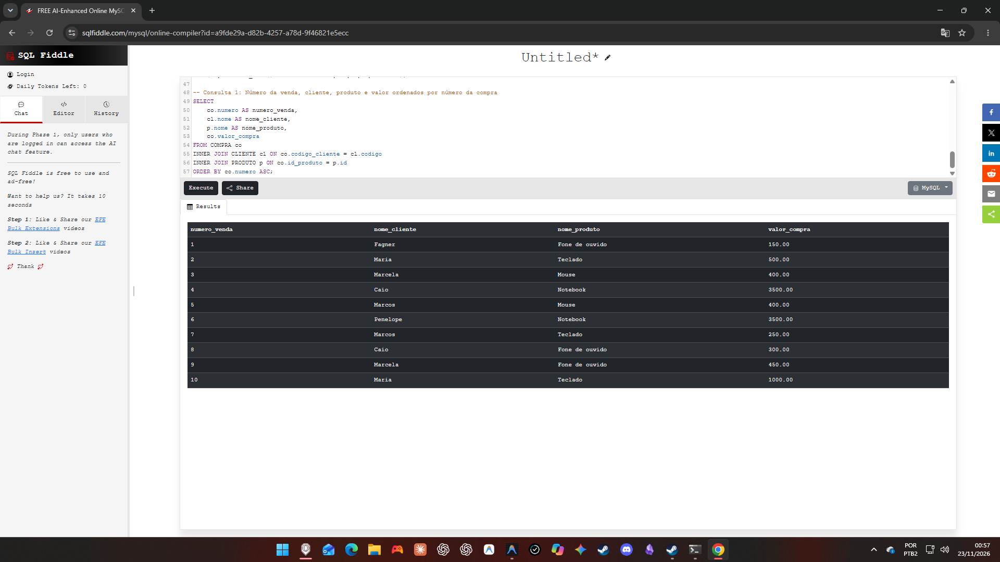
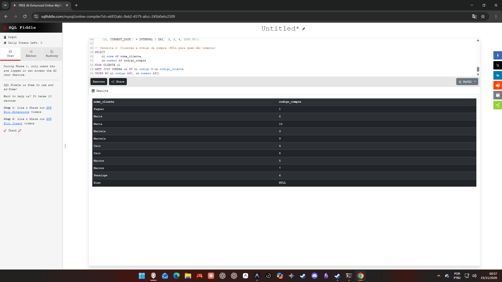
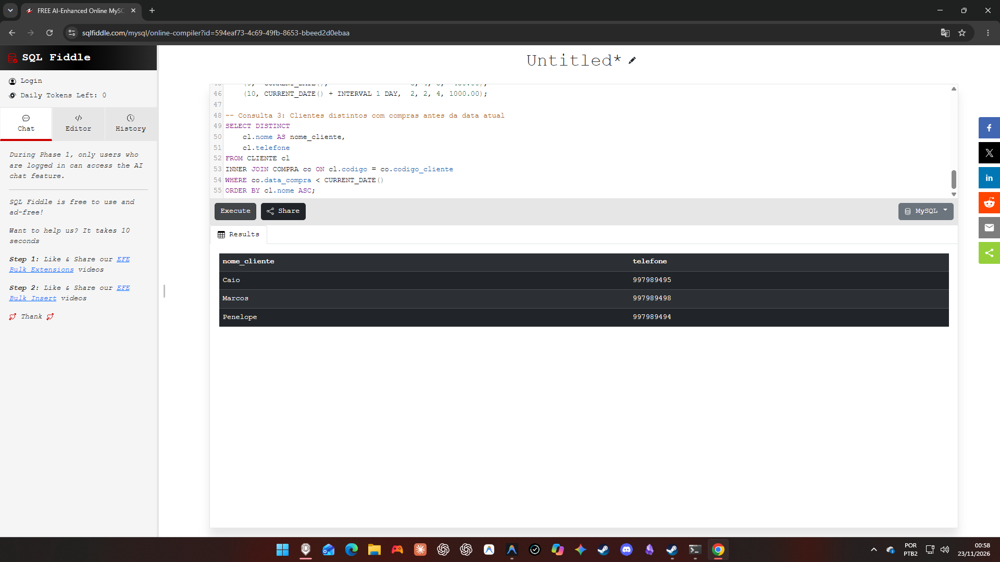

# 🛒 LOJABD — Banco de Dados Relacional de Loja Virtual (MySQL / SQL Fiddle)


Projeto prático da disciplina **Gerenciamento e Desenvolvimento em Banco de Dados** (**UNIDERP - Universidade Anhanguera** — Curso de **Sistema da Informação**, Uberlândia/MG), desenvolvido por **Bruno Cardoso De Oliveira Souza**.

Implementa a modelagem relacional, criação estrutural (**DDL**), carga inicial (**DML**) e consultas com junções (**DQL / `JOIN`**) para o banco de dados **LOJABD**, com comprovação de execução real no [SQL Fiddle](http://sqlfiddle.com/) e relatório acadêmico completo em normas **ABNT**.

---

## 📐 Modelagem Entidade-Relacionamento (ER)



---

## 📁 Estrutura do Repositório

```text
.
├── docs/
│   └── Relatorio_Aula_Pratica_Banco_de_Dados_Bruno_Souza.pdf   # Relatório final ABNT com Sumário automático
├── screenshots/
│   ├── 01_ddl_dml_e_versao.png                                 # Execução DDL + verificação da versão MySQL
│   ├── 02_verificacao_tabelas_dml.png                          # Verificação dos dados inseridos nas 3 tabelas
│   ├── 03_consulta_01_inner_join.png                           # Consulta 1 (INNER JOIN)
│   ├── 04_consulta_02_left_join.png                            # Consulta 2 (LEFT JOIN com NULL)
│   └── 05_consulta_03_distinct_before_today.png                # Consulta 3 (DISTINCT + filtro temporal)
├── sql/
│   ├── 01_ddl_lojabd.sql                                       # Criação do banco LOJABD e das 3 tabelas (InnoDB)
│   ├── 02_dml_inserts.sql                                      # Inserção de 7 clientes, 4 produtos e 10 compras
│   ├── 03_dql_consultas_join.sql                               # Consultas de verificação e 3 JOINs solicitados
│   └── sqlfiddle_schema_ddl_dml.sql                            # Script consolidado adaptado ao sandbox SQL Fiddle
├── Relatorio_Aula_Pratica_Banco_de_Dados_Bruno_Souza.docx      # Relatório editável em formato institucional (.docx)
├── publish_github.ps1                                          # Script auxiliar para push no GitHub
├── LICENSE                                                     # Licença MIT
└── README.md
```

---

## ⚙️ Etapas Desenvolvidas

### 1. DDL — Estruturação do Banco `LOJABD` ([`sql/01_ddl_lojabd.sql`](sql/01_ddl_lojabd.sql))
- Criação das tabelas `CLIENTE` (`AUTO_INCREMENT` na PK `codigo`), `PRODUTO` (`AUTO_INCREMENT` na PK `id`) e `COMPRA` (PK `numero` e chaves estrangeiras `fk_compra_cliente` e `fk_compra_produto` em `InnoDB` UTF-8).
- *Nota sobre o SQL Fiddle:* o ambiente online provisiona automaticamente o banco temporário da sessão (`sandbox_db`), retornando `ERROR 1044` para `CREATE DATABASE`. Por isso, [`sql/sqlfiddle_schema_ddl_dml.sql`](sql/sqlfiddle_schema_ddl_dml.sql) mantém `CREATE DATABASE`/`USE` comentados para execução direta no compilador web, enquanto `01_ddl_lojabd.sql` preserva os comandos completos para instâncias MySQL locais.

### 2. DML — Carga de Dados ([`sql/02_dml_inserts.sql`](sql/02_dml_inserts.sql))
- Inserção dos **7 clientes** (destaque para `Rian`, sem compras vinculadas), **4 produtos** e **10 compras**.
- Datas calculadas com aritmética padrão MySQL (`CURRENT_DATE() +/- INTERVAL N DAY`) e `valor_compra = quantidade_comprada * valor`.

### 3. DQL — Consultas com `JOIN` ([`sql/03_dql_consultas_join.sql`](sql/03_dql_consultas_join.sql))

| Consulta | Cláusulas Principais | Objetivo | Link Oficial no SQL Fiddle |
| :--- | :--- | :--- | :--- |
| **Consulta 1** | `INNER JOIN` (2x), `ORDER BY` | Retornar nº da venda, cliente, produto e valor ordenados por `numero` (10 linhas) | [Abrir Execução](https://sqlfiddle.com/mysql/online-compiler?id=a9fde29a-d82b-4257-a78d-9f46821e5ecc) |
| **Consulta 2** | `LEFT JOIN`, `ORDER BY` | Listar todos os clientes e seus códigos de compra, exibindo `NULL` para quem não comprou (`Rian`) (11 linhas) | [Abrir Execução](https://sqlfiddle.com/mysql/online-compiler?id=e6f33a6c-8eb2-4579-a6cc-245b0e6c2509) |
| **Consulta 3** | `SELECT DISTINCT`, `INNER JOIN`, `< CURRENT_DATE()` | Retornar clientes únicos e telefones com compras anteriores à data atual (`Caio`, `Marcos`, `Penelope`) (3 linhas) | [Abrir Execução](https://sqlfiddle.com/mysql/online-compiler?id=594eaf73-4c69-49fb-8653-bbeed2d0ebaa) |

Outros links de execução direta no SQL Fiddle:
- [DDL + Verificação da versão MySQL e tabelas criadas](https://sqlfiddle.com/mysql/online-compiler?id=d7959477-fea1-4c15-822b-15cc422f3116)
- [Verificação DML das tabelas `CLIENTE`, `PRODUTO` e `COMPRA`](https://sqlfiddle.com/mysql/online-compiler?id=1351ce2e-7ec3-4b75-9e13-995948ef480f)

---

## 🖼️ Evidências Reais no SQL Fiddle

### Criação das Tabelas (DDL) e Verificação do Banco


### Verificação dos Dados Inseridos (DML)


### Consulta 1 — Vendas Ordenadas (`INNER JOIN`)


### Consulta 2 — Todos os Clientes com `NULL` para Não Compradores (`LEFT JOIN`)


### Consulta 3 — Clientes Únicos Antes da Data Atual (`DISTINCT` + `INNER JOIN`)


---

## 📄 Relatório Completo (ABNT)

O relatório acadêmico completo formatado segundo as normas ABNT e o Modelo de Atividade Textual institucional encontra-se disponível em:
- [`docs/Relatorio_Aula_Pratica_Banco_de_Dados_Bruno_Souza.pdf`](docs/Relatorio_Aula_Pratica_Banco_de_Dados_Bruno_Souza.pdf)

---

## 🚀 Como Reproduzir Localmente (MySQL)

```bash
mysql -u root -p < sql/01_ddl_lojabd.sql
mysql -u root -p < sql/02_dml_inserts.sql
mysql -u root -p LOJABD < sql/03_dql_consultas_join.sql
```

---

## 📝 Licença

Distribuído sob a licença **MIT**. Consulte [`LICENSE`](LICENSE) para mais detalhes.
